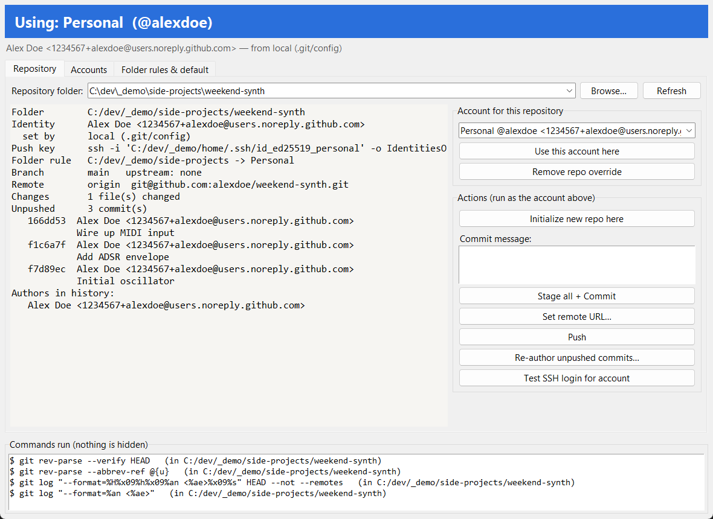

# Git Accounts

[](https://github.com/rdsparky/git-accounts/actions/workflows/tests.yml)
[](https://github.com/rdsparky/git-accounts/releases/latest)

A small Windows app (GUI and CLI) that keeps your **work** and **personal** Git/GitHub accounts apart.
It always shows which account a repository will commit and push as, and lets you switch with one click.



*Demo data. The badge colour and text show which account this repo uses.*

## Why
With two GitHub accounts on one PC it is easy to:
- commit to a personal project under your work email, because the global `user.email` wins, or
- push with the wrong SSH key, because `~/.ssh/config` picked the other one.

Git Accounts makes the active account visible and lets you fix it per repository or per folder.

## Install
You need [Git for Windows](https://git-scm.com/) in both cases.

### Option A: download the .exe (no Python needed)
Get **`GitAccounts.exe`** from the [latest release](https://github.com/rdsparky/git-accounts/releases/latest) and double-click it.

GitHub Actions builds the exe from the tagged source. It is **not code-signed**, so Windows SmartScreen may say
*"Windows protected your PC"*: click *More info* → *Run anyway*. Each release includes a `GitAccounts.exe.sha256`
checksum you can compare with `Get-FileHash GitAccounts.exe`.

### Option B: run from source (Python 3.10+, standard library only)
1. Install [Python 3.10+](https://www.python.org/downloads/windows/) with tcl/tk (the default).
2. Download or clone this repository.
3. Double-click `install-shortcuts.cmd`. This adds **Git Accounts** to the Start menu and the Desktop.
   Or double-click `GitAccounts.pyw` directly. The CLI (`gitacct.cmd`) is only available this way.

## Features
- **Badge** showing the account the selected repo uses, in that account's colour, and where it comes from:
  repo, folder rule or global default.
- **Repository tab**
  - Pin a repo to an account.
  - `git init`, *Stage all + Commit*, *Set remote URL*, *Push*.
  - Commit and push refuse to run if the repo's identity doesn't match the selected account.
  - *Re-author unpushed commits* fixes commits made under the wrong account. It only touches commits that are not on any remote, keeps author dates, and saves a backup ref under `refs/gitaccounts/backup/`.
- **Accounts tab**
  - Name, commit email, GitHub username, SSH key.
  - *Generate SSH key* creates a key and copies the public part to the clipboard.
  - *Test SSH login* shows which GitHub user a key really logs in as, and warns on a mismatch.
- **Folder rules**: for example, "everything under `C:\dev\` uses Personal". The rule is written to your global git config as `includeIf`, so it also applies in the terminal, VS Code and other tools. Your own `includeIf` entries are left alone.
- **Command log**: every git and ssh command the app runs is listed. Nothing is hidden.

## How switching works
| Level | Stored in | Wins over |
|---|---|---|
| Repo pin | the repo's `.git/config`: `user.*`, `core.sshCommand`, `credential.username` | everything |
| Folder rule | `~/.gitconfig` `includeIf "gitdir/i:<folder>/"` → `~/.gitaccounts/<id>.gitconfig` | global default |
| Global default | `~/.gitconfig` `user.*` | – |

- **SSH pushes** use the account's key through `core.sshCommand ... -o IdentitiesOnly=yes`.
- **HTTPS pushes** go through Git Credential Manager, which picks the account from `credential.username`.

## CLI
```bat
gitacct list
gitacct status C:\path\to\repo
gitacct use personal C:\path\to\repo
gitacct test personal
gitacct reauthor personal C:\path\to\repo
```

## Data and privacy
`~/.gitaccounts/profiles.json` holds the accounts, rules and recent repos. The app stores **no passwords or tokens**
and makes no network calls, apart from `ssh -T git@github.com` when you click *Test SSH login* and the git commands you trigger.

## Tests
```bat
py -3 tests\test_core.py
```
The tests run against a temporary home folder and global git config; your real `~/.gitconfig` is never touched.

## Status
Early (0.1).
- Tested on Windows 11 with Python 3.11 and 3.14 and Git 2.43. CI runs the tests on Python 3.10, 3.12 and 3.13.
- Pushing over **SSH** is tested end to end. Pushing over **HTTPS** with several accounts relies on Git Credential Manager picking the account from `credential.username`, and that has not been tested yet.
- macOS and Linux are not supported yet.

Issues and pull requests are welcome.

## License
MIT
